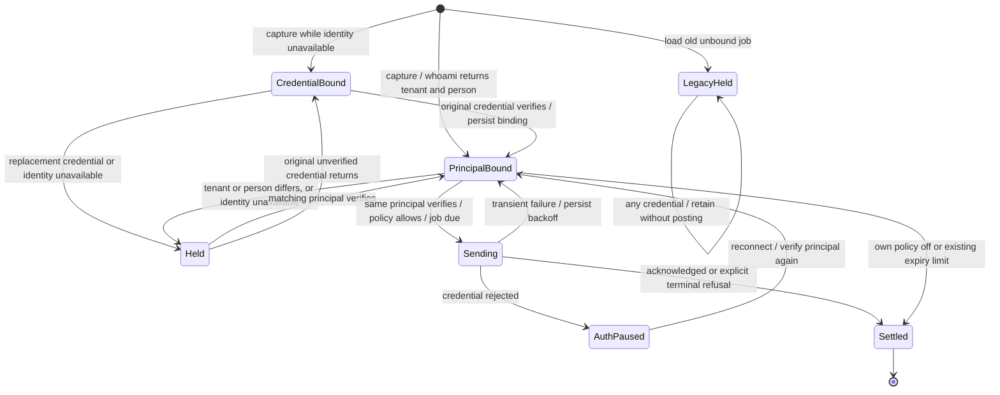

# Queued reporting principal isolation

Implemented behavior: a job stores a SHA-256 digest of the authenticated
`[tenant_id, identity_id]` returned by the existing `/v1/auth/whoami` helper,
plus a deployment/credential fingerprint. No raw credential is stored. Queue
slots include the principal (or unverified credential) so another person's
snapshot cannot overwrite held context with the same session id.

If identity is unavailable at capture, persist the credential fingerprint and
hold the job until that exact credential verifies. Persist the verified principal
before delivery. A replacement credential may send older work only when a fresh
whoami response matches its bound tenant and owning person. Credentials without
an owning identity are held. Older plugin jobs have neither binding: never adopt
them into the next login. Their origin cannot be reconstructed safely.

The install namespace retains its shared 100-job capacity, including held and
legacy jobs. A full queue reports backpressure. Held jobs are not expired, cleared
by another principal's capture-off policy, or passed to terminal upload handling.
Existing expiry, retry and explicit policy refusal behavior applies only to jobs
owned by the verified current principal. Held work reports `principal-held`, a
bounded reason code and `held_jobs` through the existing reporting status and
private status record. Held-only polling is capped at once per 15 minutes;
credential events and explicit resume attempt recovery immediately.

`Held` is an observed delivery condition; the durable job keeps its original
binding. The chart's recovery edges always recheck the original binding. It does
not claim that a new credential can establish ownership for unverified work.

## Source mapping and atomic boundaries

| Model event | Implemented boundary |
| --- | --- |
| Enqueue | `src/core/delivery.ts`: enqueue resolves key and whoami; `queue.ts`: put writes one bound record |
| Legacy | `queue.ts`: list parses missing/invalid binding as unbound |
| Switch | `src/v2/auth.ts`: reportingKey re-resolves supported environment/connection credentials |
| Whoami | `delivery.ts`: principalOf at drain, using `core/oauth.ts` and the existing authenticated endpoint |
| Bind | `delivery.ts`: original-credential match, then queue.defer persists principal before uploading |
| Deliver | `delivery.ts`: belongs filter, then per-job credential recheck and deliver with the verified pinned key |
| Restart | recreate delivery; durable job binding survives; no identity result survives |

The JavaScript promise chain serializes enqueue/drain within one delivery instance.
Storage writes are individual awaited adapter writes, not multi-record transactions.
The model assumes one active delivery instance per plugin-private spool and an
immutable tenant/person assignment for a credential. The backend re-authenticates
uploads, so a revoked key fails there. Concurrent plugin processes sharing storage,
identity reassignment of an existing credential, arbitrary disk corruption, transport
loss, server RLS, queue throughput and native client lifecycle are outside this model.

## Model and controls

Adapted from the reviewer's `hunt-capture/tlc-owner/Owner.tla`. One job, four
credentials: original, same-person rotation, another tenant, another person in the
same tenant. Initial jobs can be principal-bound, unverified credential-bound, or
legacy. Switch, restart and verification can interleave at each modeled step.

- `Bound`: no cross-principal delivery; legacy jobs are never adopted.
- `InstallOnly`: removes the principal delivery guard. Enqueue A, switch to B,
  verify B, deliver B breaks isolation (the original confirmed bug).
- `AdoptReplacement`: removes the original-credential verification guard.
  Unverified/legacy work can be adopted by B and then sent as B.

No liveness claim: holds are intentional and can require restoration of the original
credential. Legacy jobs can exhaust capacity until a future explicit recovery/purge
workflow; automatic attribution or silent deletion would violate the safety requirement.

Run with the repository shared `tlc_cases.py` runner and official TLA+ 1.7.4 jar.
Runtime regressions live in `test/principal.test.js`, including the original
environment-key reproduction, independent queue reconstruction and real loopback HTTP.
